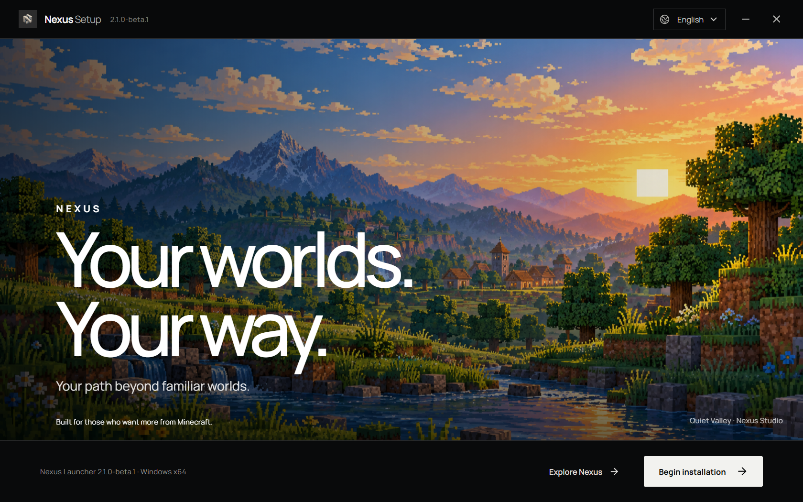

  
  <h1>Nexus Launcher</h1>
  
Лаунчер для управления и запуска сборок Minecraft Java Edition в Windows.

  
<a href="https://github.com/NexusLauncherDev/nexus-launcher/releases/download/v2.1.0-beta.1/NexusSetup.exe"><strong>Скачать Nexus Launcher 2.1.0 Beta 1</strong></a>

  
<strong>Открытая бета · Windows x64 · Установщик без цифровой подписи</strong>

  
<a href="README.md">English</a> · <a href="https://github.com/NexusLauncherDev/nexus-launcher/releases/tag/v2.1.0-beta.1">Заметки к релизу</a> · <a href="https://github.com/NexusLauncherDev/nexus-launcher/issues/new/choose">Сообщить об ошибке или предложить функцию</a>

Nexus объединяет управление инстансами, каталог Modrinth, диагностику запуска и настраиваемое рабочее пространство. Это ранняя бета: часть интеграций и вариантов Windows ещё не проверялась.

## Возможности беты

- **Управление инстансами:** создание и организация изолированных сборок, просмотр их содержимого и запуск игры.
- **Каталог Modrinth:** поиск проектов и установка совместимого контента в выбранный инстанс.
- **Nexus Studio:** альтернативное рабочее пространство для библиотеки и настроек инстансов.
- **Cinematic Launch:** экран запуска с текущим прогрессом и поддержкой уменьшения анимации.
- **Mod Intelligence:** сканирование локальных файлов модов и просмотр подтверждённых диагностических сведений.
- **Crash Investigator:** разбор локальных игровых журналов и ограниченная, очищенная от части данных сводка.
- **Nexus Companion:** просмотр измеренных показателей отслеживаемого игрового процесса.
- **Nexus Setup 2.0:** выбор папки, установка или обновление лаунчера и проверка файлов.

Доступность функций зависит от профиля, файлов игры, сетевых сервисов и конфигурации инстанса. Перед установкой прочитайте [известные ограничения](#известные-ограничения).

## Скриншоты

Выше показан настоящий стартовый экран Nexus Setup. [Сцена из встроенного обзора](assets/screenshots/setup-showcase.png) снята в выпущенном установщике и использует оригинальную иллюстрацию проекта.

## Системные требования

- Windows x64. Текущая бета проверена на одной машине с Windows 11 24H2 x64 (сборка 26100). Это результат проверки, а не заявление о поддержке других редакций Windows.
- Для загрузки файлов игры, контента Modrinth и компонента WebView2, если его нет, требуется интернет.
- Файлы Minecraft Java Edition и учётная запись или право на игру, необходимые выбранному профилю.

Windows 10, Windows Server, устройства ARM и другие сборки Windows в этом релизе не проверялись.

## Установка

1. Скачайте `NexusSetup.exe` со страницы [релиза v2.1.0-beta.1](https://github.com/NexusLauncherDev/nexus-launcher/releases/tag/v2.1.0-beta.1).
2. При желании сравните SHA-256 файла со значением в приложенном к релизу `SHA256SUMS.txt`.
3. Запустите установщик и выберите папку назначения. Установка выполняется для текущего пользователя; заменять существующую папку не требуется.
4. Запустите Nexus с экрана завершения установки или из меню «Пуск».

У установщика нет цифровой подписи Authenticode. Windows SmartScreen может показать предупреждение о неизвестном издателе. Перед запуском проверьте скачанный файл и его SHA-256. Если WebView2 отсутствует, Setup предложит подписанный Microsoft Evergreen bootstrapper; для этого потребуется интернет.

Установщик проверен в изолированном сценарии установки и обновления. Объём проверок и то, что не удалось проверить на этой машине, указаны в заметках к релизу. Не закрывайте Setup после начала записи файлов.

## Обновление

Проверенного механизма автоматического обновления лаунчера сейчас нет. Скачайте следующий установщик со страницы GitHub Releases и запустите его поверх текущей установки. Setup определяет существующую папку и сохраняет неуправляемые им данные лаунчера.

## Известные ограничения

- Бета проверена на одном компьютере с Windows 11 24H2 x64; совместимость с другими версиями Windows не подтверждена.
- Установщик не подписан, поэтому SmartScreen может определить издателя как неизвестного.
- В этой бете недоступны вход Microsoft и загрузки CurseForge. Доступность провайдеров может измениться при завершении интеграций.
- Автоматического обновления лаунчера нет; обновляйте его вручную через Releases.
- Сетевые сервисы, авторизация, загрузчики модов и версии Minecraft проверены не во всех комбинациях.
- Nexus Launcher — независимый проект сообщества. Он не связан с Mojang или Microsoft, не одобрен и не спонсируется ими.

## Обратная связь

Используйте [Issues](https://github.com/NexusLauncherDev/nexus-launcher/issues/new/choose), чтобы сообщить о воспроизводимой ошибке или предложить функцию. Перед прикреплением журналов удалите из них имена аккаунтов, токены, адреса электронной почты и приватные пути. Не публикуйте пароли и токены авторизации.

## Лицензия

Nexus Launcher и Nexus Setup — проприетарные бинарные продукты. Исходный код в этом репозитории не размещён. [Лицензия бинарных файлов](LICENSE) распространяется только на компоненты Nexus; сторонние компоненты остаются под условиями из [THIRD_PARTY_NOTICES.md](THIRD_PARTY_NOTICES.md).
